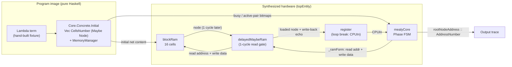
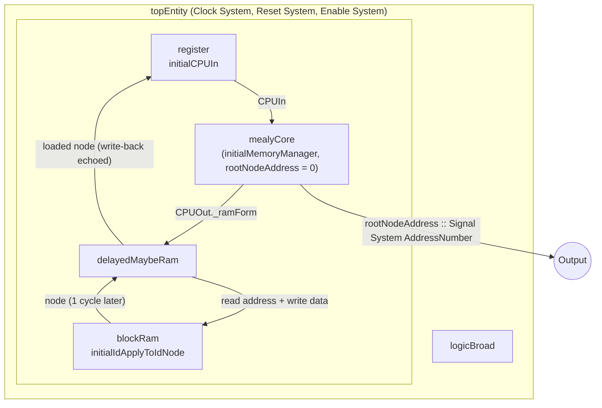
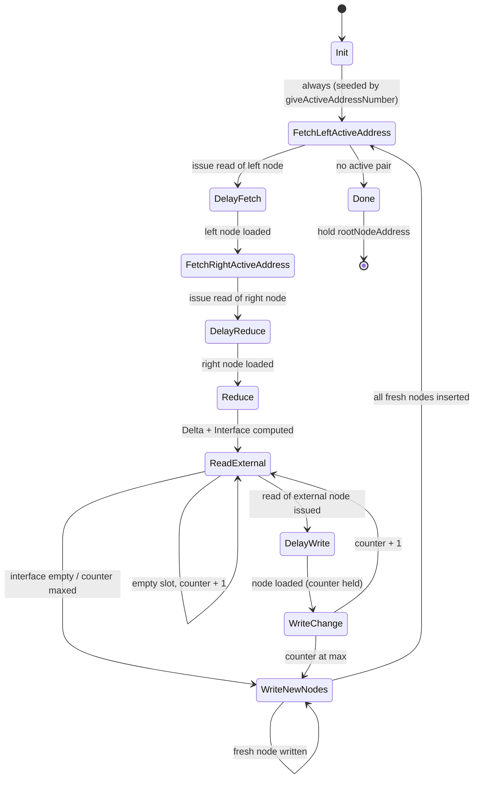
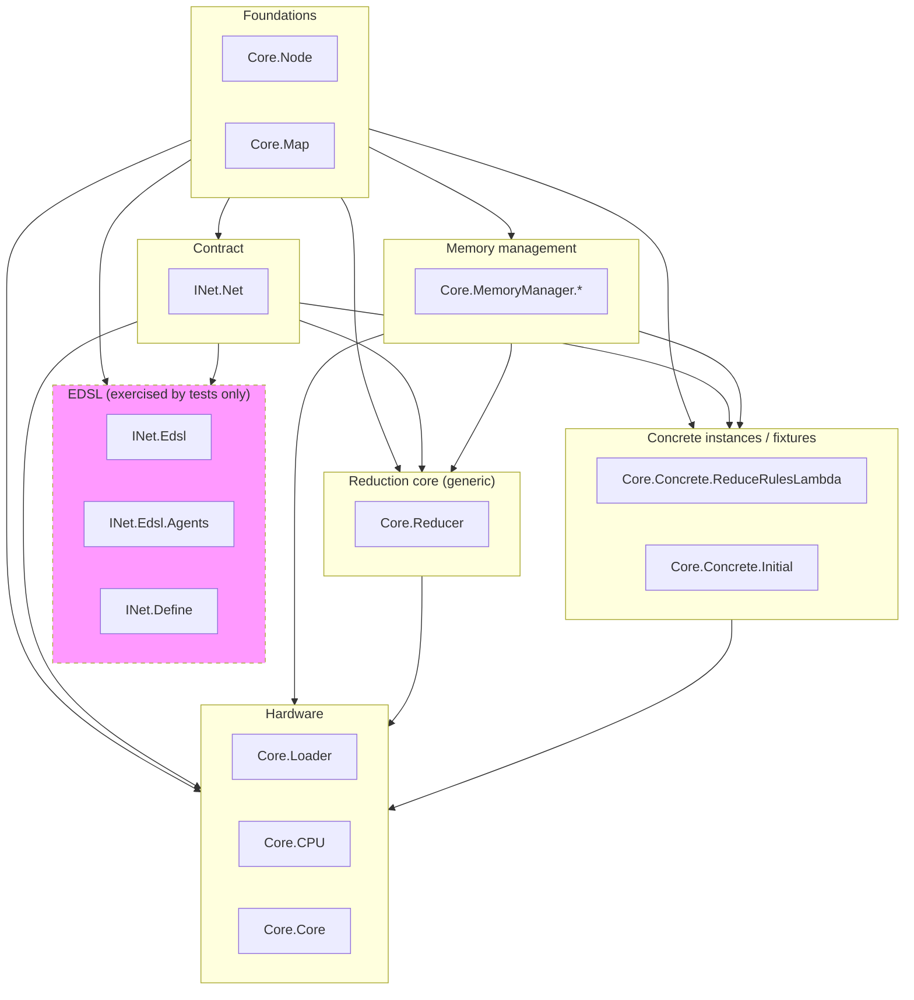

# lamagraph-core Architecture

Interaction-net based processor written in Clash, compiled to FPGA hardware. This document describes the module layout, the reduction pipeline, the hardware topology, and the data types shared between modules.

**Reading order.** Sections 2–4 give the big picture (pipeline, hardware, FSM); sections 5–7 cover the import graph, data types, and rules; sections 8–10 collect reference material (glossary, invariants, limitations). Companion file: [build.md](build.md) — build, test and cross-cutting conventions. The per-module reference lives in Haddock: build it with `cabal haddock` and start from the `Core.Core` → `Core.CPU` → `Core.Reducer` pages.

---

## 1. Overview

lamagraph-core implements a graph reducer. A program is represented as an interaction net — a graph of nodes connected by edges — and reduction proceeds by rewriting *active pairs* (two nodes joined by their principal ports) until none remain.

- **Language / toolchain.** Haskell compiled by Clash into SystemVerilog/VHDL (`clash-prelude >= 1.8.1 && < 1.10`).
- **Memory model.** A fixed 16-cell RAM (`CellsNumber = 16`), addresses are `Unsigned 4` (`AddressNumber`). Wiring is by `(address, portId)` pointers — no direct references.
- **No front-end.** There is no parser; initial nets are hand-built `Vec` fixtures in `Core.Concrete.Initial`.
- **Rule sets.** Two parallel agent sets exist: the hand-written set used for synthesis (`Core.Concrete.ReduceRulesLambda`) and the EDSL-written set used by tests (`INet.Define`).

---

## 2. Reduction Pipeline



Pipeline stages:

1. **Fixture.** `Core.Concrete.Initial` provides the initial net as `Vec CellsNumber (Maybe (Node portsNumber agentType))`, plus a `MemoryManager` marking busy cells and the root active pair (address `0`).
2. **Image load.** `Core.Core.logicBroad` feeds the fixture into `blockRam` as its initial content.
3. **Reduce loop.** `Core.CPU.mealyCore` runs the `Phase` FSM: pick an active pair, fetch both nodes, call `Core.Reducer.reduce`, patch external neighbors, insert fresh nodes, mark new active pairs, repeat.
4. **Termination.** When the active-pair bitmap is empty the FSM enters `Done` and holds `_rootNodeAddress` — the address of the root node, visible as the per-cycle output of `topEntity`.

---

## 3. Hardware Topology

`topEntity` (src/Core/Core.hs) instantiates the whole processor:



Key points:

- **Loop closure.** In `logicBroad` the register sits on the CPU *input*, not on its output: `i = register initialCPUIn nextInput`, `o = mealyCore … i`. `CPUOut._ramForm` drives `blockRam` directly through `delayedMaybeRam` (read address + write data in one `RamForm`); the RAM node output, echoed together with the write-back `RamForm`, becomes `nextInput` for the next cycle. The register breaks the combinational path from `mealyCore` output back to its input; `delayedMaybeRam` gates the RAM with a one-cycle-delayed copy of the command (`delay Nothing inputRamForm`) so reads land one cycle after the address.
- **Ports.** `makeTopEntity 'topEntity` generates the auto-named ports `clk`, `rst`, `en`, `rootNodeAddress`.
- **Genericity.** `topEntity` fixes the parameters: `logicBroad @2 @2 @2 @AgentSimpleLambda initialIdApplyToIdNode 0 initialIdApplyToIdMM` — 2 secondary ports, 2 fresh nodes and 2 edges per rule step, hand-written lambda agent set.
- **Observation.** The result of reduction is visible as the address trace of the root node; there is no separate output bus.

---

## 4. Reduce Loop FSM

The `Phase` state machine in `Core.CPU` (`step`, driven by Clash `mealyS` through `mealyCore`):



State codes carry the loop counter: `ReadExternal c`, `WriteChange c` walk `c = 0 .. 2*portsNumber-1`; `WriteNewNodes c` walks `c = 0 .. nodesNumber-1`. A distinct `DelayWrite` state waits one cycle for `blockRam` data after `ReadExternal` issues the read, then hands over to `WriteChange` with the counter preserved. Exact transition rules are documented in the Haddock of `Core.CPU` (on `Phase` and `step`).

| Phase | Role |
|---|---|
| `Init` | Seed the loop: pick the first active pair via `giveActiveAddressNumber`. |
| `FetchLeftActiveAddress` / `FetchRightActiveAddress` | Issue RAM reads for the two nodes of the current active pair. |
| `DelayFetch` / `DelayReduce` / `DelayWrite` | Compensate `blockRam` one-cycle read latency. |
| `Reduce` | `removeActivePair` → `Core.Reducer.reduce` (allocates addresses, calls `makeReduction`, builds `Delta`) → `getInterface` → `getAllChangesByDelta` → `changeRootNode`. |
| `ReadExternal` | Walk the fixed-size `Interface` vector, fetching every external neighbor of the dying pair (one element per cycle, counter-indexed). |
| `WriteChange` | Apply the computed `Changes` map to those neighbors in RAM. |
| `WriteNewNodes` | Insert fresh nodes produced by the rule and `writeNewActives` (mark new active pairs in the `MemoryManager` bitmap). |
| `Done` | No active pairs left; the held `_rootNodeAddress` is published as the output. |

Two field names exist for the root address, in different records: `CPUState._rootNodeAddress` holds the state (updated by `changeRootNode` in `Reduce`), and `CPUOut._nextRootNodeAddress` is the per-cycle output port — `defaultOut`/`step` copy the state field into it every cycle.

`externalNodesNumber = portsNumber * 2` — the interface covers all ports of both pair nodes. All counter walks are bounded by type-level sizes; vectors are fixed-size, so phases take a statically known number of cycles.

### 4.1 Cycle budget of one reduction step

`blockRam` data appears one cycle after the address (`delayedMaybeRam` gates the output with `delay Nothing inputRamForm`) and reaches the FSM input through the `register` in `logicBroad` — so a node issued at cycle *t* is usable by `step` at *t+2*. The `Delay*` states cover exactly this gap while re-emitting `_previousRamForm` (the command is held for an extra cycle).

```mermaid
sequenceDiagram
    participant F as Phase FSM (Core.CPU)
    participant R as blockRam (via delayedMaybeRam)

    Note over F,R: Fetch pair — 5 cycles total
    F->>R: t+0 FetchLeftActiveAddress: read left node
    Note over F: t+1 DelayFetch holds the read command
    F->>R: t+2 FetchRightActiveAddress: read right node (address from left principal port)
    Note over F: t+3 DelayReduce, t+4 Reduce: right node arrives; compute Delta, Interface, Changes
    loop external slot c = 0 .. 2*portsNumber-1 (interface walk)
        F->>R: ReadExternal c: read external node
        Note over F: DelayWrite c: one cycle for RAM data
        F->>R: WriteChange c: patch ports, write back
    end
    loop fresh node c = 0 .. nodesNumber-1
        F->>R: WriteNewNodes c: write fresh node from FSM state (no read)
    end
    Note over F: → FetchLeftActiveAddress for next pair, or Done when bitmap empty
```

Static cycle counts, derived from `step` (for `topEntity`: `portsNumber = 2` → interface slots ≤ 4, `nodesNumber = 2`):

| Visit | Cycles | Condition |
|---|---|---|
| `Init` | 1 | once, at startup |
| `FetchLeft → DelayFetch → FetchRight → DelayReduce → Reduce` | 5 | every active pair |
| interface walk | 1 | fully empty (`_interface == def` jumps straight to `WriteNewNodes`) |
| one empty interface slot | 1 | slot = `Nothing`, counter + 1 |
| one wired interface slot | 3 | `ReadExternal → DelayWrite → WriteChange` |
| `WriteNewNodes` | 1 | no fresh nodes (`_nodesToWrite == def` — e.g. beta) |
| `WriteNewNodes` | `nodesNumber` (2) | ≥ 1 fresh node: the vector is walked to `maxBound` |

Total per active pair for `topEntity`: 5 + interface walk (1, or `3k + (4−k)` for `k` wired slots) + write-back (1 or 2) → worst case 19 cycles. Counts are exact because every vector involved is sized at the type level (see [build.md](build.md), Cross-Cutting Conventions).

---

> **See also.** Per-module reference: Haddock (`cabal haddock`, start from `Core.Core`). Build, test details and cross-cutting conventions: [build.md](build.md).

## 5. Module Dependency Graph

Project-internal imports, aggregated by layer (the per-module edges are in the generated graph below). Each arrow `A --> B` means *modules of A are imported by modules of B*, so dependencies point down the layer stack. Any arrow running against the layer direction would be visible at a glance — none exist.



The EDSL layer is a dead end in the import graph: nothing in `src/` imports `INet.Edsl`, `INet.Edsl.Agents`, or `INet.Define`; they are exercised by the test suite and intended for future front-ends.

**Authoritative version.** This layer overview is maintained by hand. The machine-extracted per-module graph is generated from `import` lines by `agent-scripts/gen-module-graph.sh` into [module-graph.generated.md](module-graph.generated.md) — if the two ever disagree, regenerate and trust the generated one. Consistency of the docs set (freshness of the generated graph, relative links, exposed-module counts) is checked by `agent-scripts/check-docs.sh`; run it after editing anything under `docs/`.

Layer summary:

| Layer | Modules |
|---|---|
| Foundations | `Core.Node`, `Core.Map` |
| Contract | `INet.Net` |
| EDSL (tests only) | `INet.Edsl`, `INet.Edsl.Agents`, `INet.Define` |
| Memory management | `Core.MemoryManager.MemoryManager`, `…NodeChanges`, `…ChangesAccumulator` |
| Reduction core (generic) | `Core.Reducer` |
| Concrete instances / fixtures | `Core.Concrete.ReduceRulesLambda`, `Core.Concrete.Initial` |
| Hardware | `Core.Loader`, `Core.CPU`, `Core.Core` |

### 5.1 Module map

All 15 exposed modules; the per-module reference (exports, contracts, invariants) lives in Haddock.

| Module | Responsibility | Layer |
|---|---|---|
| `Core.Node` | Net data types: `Node`, `Port`, `Edge`, addresses. | Foundations |
| `Core.Map` | Tiny address-keyed association `Vec` for accumulated updates. | Foundations |
| `INet.Net` | Agent-set interface: `ReduceRuleResult`, `INet` class. | Contract |
| `INet.Edsl` | Builder DSL for reduction-rule bodies; generic `AgentLabel` class. | EDSL |
| `INet.Edsl.Agents` | Template Haskell generator for an agent-set declaration skeleton. | EDSL |
| `INet.Define` | Lambda agent set wired through the EDSL (tests only). | EDSL |
| `Core.MemoryManager.MemoryManager` | Busy/active-pair bitmaps, free-address allocation. | Memory management |
| `Core.MemoryManager.NodeChanges` | `Delta` / `Interface` / `Changes` types; applying patches. | Memory management |
| `Core.MemoryManager.ChangesAccumulator` | `Delta` → per-external-node `Changes` map. | Memory management |
| `Core.Reducer` | Generic reduction step: rule application plus rewiring. | Reduction core |
| `Core.Concrete.ReduceRulesLambda` | Hand-written 3-agent rule set used by `topEntity`. | Concrete instances |
| `Core.Concrete.Initial` | Initial-net fixtures with matching `MemoryManager`s. | Concrete instances |
| `Core.Loader` | Signal-level RAM access (plus deprecated helpers). | Hardware |
| `Core.CPU` | The reduction finite-state machine. | Hardware |
| `Core.Core` | CPU + RAM wiring; `topEntity`. | Hardware |

---

## 6. Core Data Types

The diagram below shows Haskell records and sum types rendered as UML classes; `Connection` and `Interface` are type aliases, not classes.

```mermaid
classDiagram
    class Node {
        +_primaryPort Connection
        +_secondaryPorts Vec of Maybe Connection
        +_nodeType agentType
    }
    class Port {
        +_nodeAddress AddressNumber
        +_portConnectedToId IdOfPort
    }
    class IdOfPort {
        <<sum type>> Primary or Id of Index
    }
    class Connection {
        <<type alias>> Maybe of Port
    }
    class LoadedNode {
        +_containedNode Node
        +_originalAddress AddressNumber
    }
    class Edge {
        +_leftEnd Connection
        +_rightEnd Connection
    }
    class ActivePair {
        +_leftNode LoadedNode
        +_rightNode LoadedNode
    }
    class Delta {
        +_newNodes Vec of Maybe LoadedNode
        +_newEdges Vec of Maybe Edge
        +_activePair ActivePair
    }
    class Interface {
        <<type alias>> Vec of Maybe AddressNumber
    }
    class Changes {
        +_secPorts Vec of Maybe Connection
        +_primePort Maybe Connection
    }
    class MemoryManager {
        +_busyBitMap Vec 16 Bool
        +_activePairs Vec 16 Bool
    }

    Node *-- Connection : primary + secondaries
    Connection ..> Port : type alias: Maybe of Port (null = free)
    Edge *-- Connection : two ends
    LoadedNode *-- Node
    ActivePair *-- LoadedNode : two pair nodes
    Delta *-- LoadedNode : _newNodes
    Delta *-- Edge : _newEdges
    Delta *-- ActivePair
    Interface ..> ActivePair : external neighbors of the pair
    Changes ..> Connection : patch per port
    MemoryManager ..> ActivePair : scheduling
    Port ..> Port : pointer: address + portId
```

Conventions:

- **Pointers, not references.** A `Port` names another node's address plus a port id (`Primary` or `Id (Index portsNumber)`) — the `Port ..> Port` arrow. The net is `Vec CellsNumber (Maybe Node)` — `Nothing` = free cell.
- **Three-state secondary slots.** `_secondaryPorts` is a *double* `Maybe`: `Vec portsNumber (Maybe (Connection portsNumber))` where `Connection` itself is `Maybe Port`. So `Nothing` = void slot (arity padding), `Just NotConnected` = free, `Just (Connected …)` = wired. `Changes._primePort` repeats the same pattern (`Maybe (Connection …)`) so a patch can leave the principal port untouched (`Nothing` = keep old).
- **`Delta` → `Changes`.** `reduce` produces a `Delta` (new material) and an `Interface` (which external nodes must be patched); `ChangesAccumulator` turns the pair into a `Map` of per-node `Changes` the FSM writes back.

---

## 7. Reduction Rules

The synthesized rule set (`Core.Concrete.ReduceRulesLambda`, instance `INet AgentSimpleLambda 2 2 2`):

| Rule | Active pair | Fresh nodes | Fresh edges | Diagram |
|---|---|---|---|---|
| Beta | `Apply >< Abstract` | 0 | 2 (secondary ports zipped) | `docs/apply_to_lambda_rule.svg` |
| Erasure propagation | `Erase >< X` | 2 (`Erase`, one per secondary of X) | 0 | `docs/eps_apply_rule.svg` |
| Erasure meet | `Erase >< Erase` | 0 | 0 | — |

The EDSL rule set (`INet.Define`, instance `INet AgentSimpleLambda 4 2 2`) implements the same three rules plus duplicator rules (`dupAnyBody`), with allocation counts beta 0, erase-any 2, dup-any 4. It is verified against the hand-written set by property and unit tests but is not yet wired into `topEntity`.

SVG net diagrams for individual interactions also live in `docs/`: `apply.svg`, `absApplyEmptyInterface.svg`, `absApplyNonEmpty.svg`, `absApplyRecInterface.svg`, `eraseEraseEmptyInterface.svg`, `idToIdReduceRes.svg`, `reduceLoopEdge.svg`.

---

## 8. Glossary

| Term | Meaning |
|---|---|
| Active pair | Two nodes joined by their principal ports (`nodeIsActive`, `Core.Node`); the unit of reduction. |
| Principal / secondary port | The principal port takes part in interaction; secondary ports wire to neighbours. `IdOfPort`: `Primary` or `Id i`. |
| Cell | One of the 16 RAM slots holding a node, addressed by `AddressNumber` (`Unsigned 4`). |
| Root node | Entry point of the net; its address lives in `CPUState._rootNodeAddress`, is carried across reductions by `changeRootNode` and is the output of `topEntity`. |
| Interface | `Interface (2 * portsNumber)` — the addresses of all external neighbours of the current active pair; the loop variable of the `ReadExternal` / `WriteChange` phases. |
| Delta | The full effect of one rule firing: fresh nodes, new wires, the consumed pair (`toDelta` output, `Core.MemoryManager.NodeChanges`). |
| Changes | A per-node patch of port connections, accumulated by `Core.MemoryManager.ChangesAccumulator` and applied by the `WriteChange` phase. |
| Fixed sizes | `portsNumber` = arity of agents (2 in both rule sets), `nodesNumber` ≤ `CellsNumber` (16), `edgesNumber` ≤ `2 * (portsNumber + 1)`, `externalNodesNumber` = `2 * portsNumber`. |

---

## 9. Invariants

Held by construction and/or checked in code; violations abort with `errorX` rather than corrupting state.

1. **Wiring symmetry.** Any `Connected` reference from port X to port Y is mirrored by a reference back from Y to X. Established by the hand-built fixtures (`Core.Concrete.Initial`) and by `INet.Edsl.wire`, and preserved by `edgesReduction` / `nodesActiveReflexivityReduction`. Not machine-checked globally; unit and property tests assert it on the fixtures and rule outputs.
2. **One marked endpoint per active pair.** In `_activePairs` exactly one of the pair's two addresses is marked; `deleteActivePair` aborts otherwise (`Core.MemoryManager.MemoryManager`).
3. **Every external neighbour gets at least one change.** After a reduction each neighbour's port that pointed into the dying pair must be redirected, so its `Changes` entry exists; `updateLoadedNodesByChanges` aborts if it does not (`errorX "External node has no changes"`). The `WriteChange` phase of `Core.CPU` treats a missing patch as "free the cell" — reachable only from a malformed `Delta`.
4. **Mirror convention in the hand fixtures.** Secondary wiring in `Core.Concrete.Initial` always pairs `Port a (Id j)` with `Port a (Id (1 - j))`.
5. **Three-state secondary slots.** `Node._secondaryPorts` uses a double `Maybe`: outer `Nothing` = padding slot (agent arity < `portsNumber`), inner `NotConnected` = free port (`Core.Node`).
6. **Allocation law.** `getAddressesAllocationCount` equals the number of addresses `makeReduction` actually consumes from the free-address vector (an `INet` law; asserted by the test suite).
7. **Active detection via principal ports.** A node is active iff its principal port meets another principal port; pairs created by a rule are detected the same way (`nodeIsActive`, `getActiveAddresses`).

---

## 10. Limitations and Roadmap

- **16 cells, no collection.** `AddressBitSize = 4` fixes memory at 16 nodes and there is no garbage collector or paging. When fewer free cells remain than a rule needs, `getFreeAddresses` returns a `Nothing`-padded pool and the rule body aborts (`errorX "fresh: free address pool exhausted"` in `INet.Edsl`, pattern-match failure in `eraseToAbstractOrApplyRule`). Widening the address/busy-bitmap pair or adding collection is a roadmap item.
- **No front-end.** There is no parser; nets enter as hand-built fixtures (`Core.Concrete.Initial`) or as Haskell code in the EDSL (`INet.Define`). A generator for the initial fixtures is planned (noted in the `Initial` module header).
- **EDSL rule set not synthesized.** `INet.Define` (4 addresses per pair) is equivalent to the hand-written set per tests but `topEntity` is fixed to the 2-address set; wiring the EDSL set in is roadmap work.
- **One reduction at a time.** The CPU picks the lowest marked active address per step (`giveActiveAddressNumber`) — sequential reduction, no parallel active-pair handling.
- **Dead code kept out of the build.** `Core.Concrete.TypesTH` moved to `experimental/` (its Template-Haskell-generated type lacked the `NFDataX` / `ShowX` / `Default` instances Clash requires; nothing imported it) — see `experimental/README.md`.

